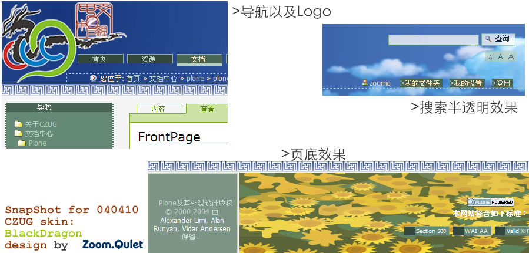
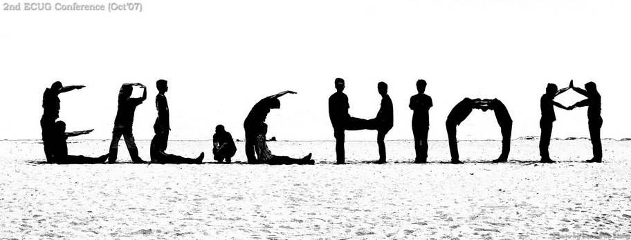
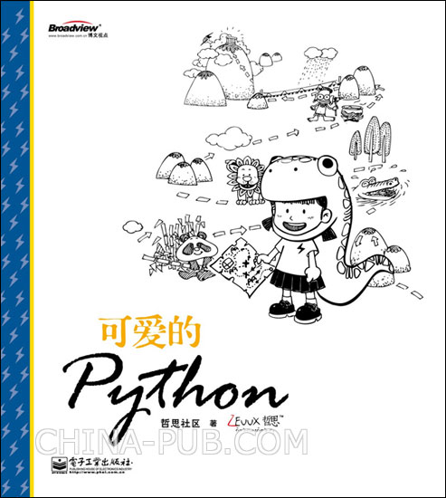

% AI时代的基本素养
% 普通人构建 LLM 生产力环境故事..
% 金山软件|Chaos42DAMA

# 但行

## AIGCx珠海

## 大妈
>- 岁数 42+
>- 工作 23+
>- 出版 3+
>- 蟒龄 21+
>- ...

## 学习
> IT 行业底色

## 大学
> 课本

>- Pascal
>- C
>- C++(毕业设计)

## 自学
> 就业向

>- PhotoShop
>- 3DMAX
>- CoreDraw
>- Illustrator
>- ...

## 常州
> 利诚通讯

>- Flah/ActionScript
>- PHP

## 上海
> 讯博数码科技

>- ASP
>- Dreamwaver
>- XML/XSL/CSS/JS/...

## 社区
> blogging

>- NucleusCMS
>- Plone
>- Zope
>- CZUG

-------

## Python
> 2003~ 啄木鸟

- mailman
- MoinMoin 1.4.*

## 北京
> SINA.com

>- PHP/CVS管理器
>- FreeBSD
>- Linux

## Ubuntu
> 2005~ 

日用

## CPUG
> 2005 ~ 

- BPUG
- ...
- python-cn@googlegroups

## Erlang
> 2007 ~ 金山

- ECUG
- [erlbattle](https://github.com/ZoomQuiet/erlbattle)
- 2010->实效云用户组

-------

## sociallearnlab.org
> 教育大发现 2008 ~ 2013

[社区顾问](#?)

## [开源卫士](http://code.ijinshan.com/)
> 2012~13 49期讲座

- golang
- node.js
- OpenResty
- crx.
- SAE
- ...

## Dart
> 2013 ~ GDG 珠海

AngularJS ..

## Scheme
> 2017

LISP..Haskell

## TypeScript
> 2018 ... Flutter

## TFUG 珠海
> 190214 ~ AI 落地

- TersnorFlow
- Keras
- FAST.ai
- ...

## Rust
> 2019

尝鲜...

## 未来
> .. 好奇什么, 就学什么

# 好事

## 开发
> 本分

- 3D 动画
- 职业顿悟
- ...

## 管理
> 过程改进

用**技术**改善**技术人**生活品质

## 写作
> 爱好

>- 22CC
>- 34年前的 Sci-Fi 小说

------

------

-------

## 社区
> GNU 感召

> - 进入
> - 理解
> - 服务
> - 发起
> - 策划
> - etc.

## 社群
> 社区群落 ~> 领域流量

- 有关联
- 场景向
- 自运营
- ...

## 自怼
> DebugUself

有心无心,自然聚集

------

## 分享
> 有好东西一定给小朋友们分享

# 莫问

## 故事
2023.12

# 前程

## 小结
四问

# (￣▽￣)

## 幻灯
> NOT PPT

[slides.zoomquiet.io/base4opc](hhttps://slides.zoomquiet.io/base4opc)

## 是也乎
- 261031 现场
- 261019 定稿
- 261014 上线
- 261010 init.

## Q&A
> ask**DAMA**@**g**oo**g**le**g**roup**s**.com
