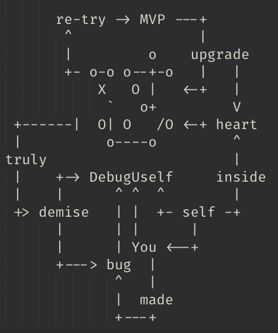
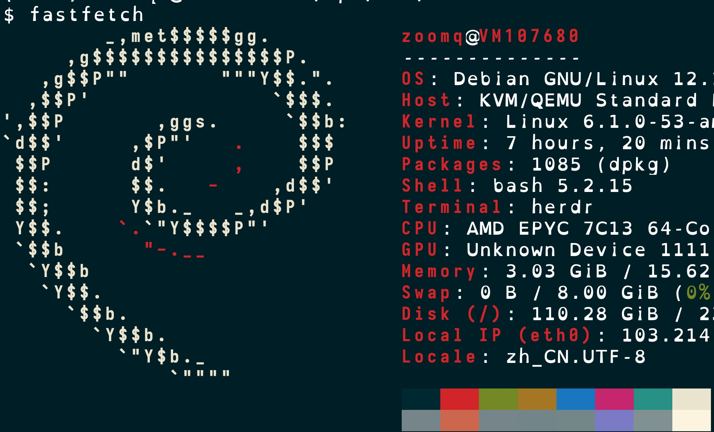
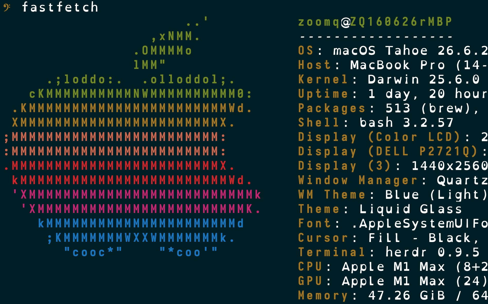
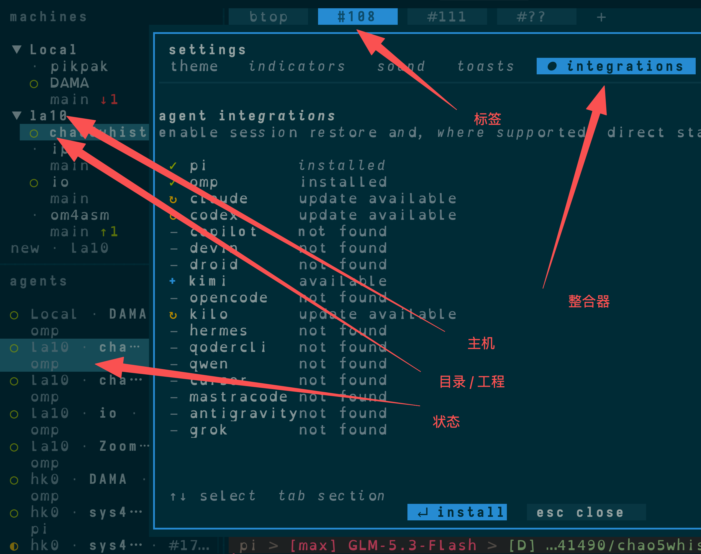
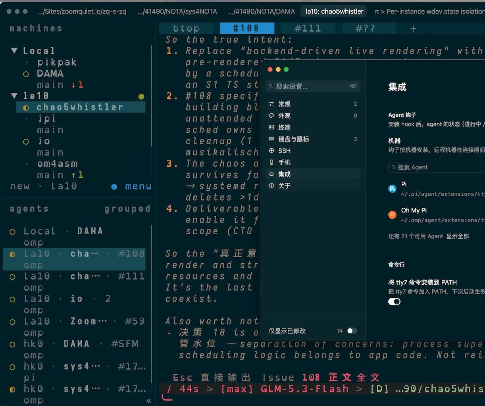
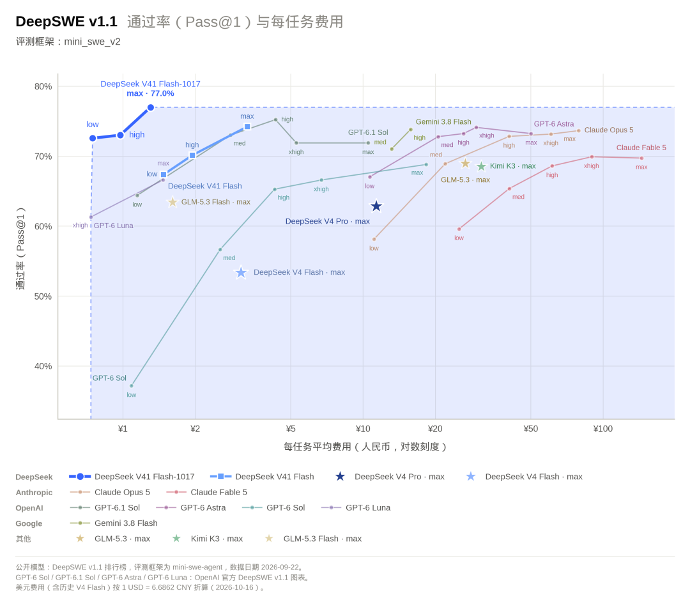

% AI时代<br/>基本素养
% 普通人构建 LLM 生产力环境故事..
% 金山软件|Chaos42DAMA

# 但行

## 大纲
> - 5' 背景
> - 20' 故事
> - 15' 小结
> - 5' QA

## 大妈
>- 年龄 52
>- 蟒龄 24+
>- 工龄 23+
>- 出版 3+
>- OPC 3+
>- ...

## Python
> 2002~ 啄木鸟

- mailman
- MoinMoin 1.4.*

## 北京
> 2004~ SINA.com

>- PHP/CVS管理器
>- FreeBSD
>- Linux

## Ubuntu
> 2005~ 

日用

## CPUG
> 2005 ~ 

- BPUG
- ...
- python-cn@googlegroups

## Erlang
> 2007 ~ 金山

- ECUG
- [erlbattle](https://github.com/ZoomQuiet/erlbattle)
- 2010->实效云用户组

-------


## sociallearnlab.org
> 教育大发现 2008 ~ 2013

[社区顾问](https://github.com/ZoomQuiet/sociallearnlab/blob/master/wiki/ZqSayCommunityCreat.wiki)

## [开源卫士](http://code.ijinshan.com/)
> 2012~13 49期讲座

- golang
- node.js
- OpenResty
- crx.
- SAE
- ...

## Dart
> 2013 ~ GDG 珠海

AngularJS .. Flutter

## Scheme
> 2017

LISP..Haskell

## TFUG 珠海
> 190214 ~ AI 落地

- TersnorFlow
- Keras
- FAST.ai
- ...

## Rust
> 2019

尝鲜...

## 未来
> .. 需要什么, 就**用**什么

# 好事

## 管理
> 过程改进

用**技术**改善**技术人**生活品质

## 写作
> 爱好

>- 22CC
>- 34年前的 Sci-Fi 小说

------


------


-------


## 社区
> GNU 感召

> - 进入
> - 理解
> - 服务
> - 发起
> - 策划
> - etc.

## 自怼
> DebugUself

有心无心,自然聚集


------



------


## 幼儿园
> 有好东西一定给小朋友们分享

# 莫问

## 日常
~ 420+CNY/m

> - Grok Bot
>    + 定期热点总结
>    + 定期记忆整理
>    + 随时调研报告...
> - herdr: omp + pi
>    + 系统/工具/服务/.. 开发
>    + 运维/发布/自动化..

## 故事
AI 关系时间线

> - 2023 聊
> - 2024 辅助..开发
>   + 2024.7 Claude MAX 订阅
> - 2025 主力开发
> - 2026 全面替代

------



------



## 聊起
> ChatGPT

- 搜索引擎
- 小作文
- .. 没了

## 用起
> `ANTHROP\C`  

- Claude
  + 调研
  + Opus
    + 写作
    + 编程..参考
> - 问, 复制, 调试

## 主力
> `ANTHROP\C`  

> - Claude Code
>   + Copilot 之后生产力工具
>   + Opus 4.8 ..
>   + YOLO
>   + [CC-Switch](https://github.com/farion1231/cc-switch)
> - Codex .. gpt-5.5

## 全力
> 工程化并行

> - gh
>    + Issue
>    + Repo.
>    + Actions
> - fj
>    + [forgejo](https://forgejo.org/)
>    + golang 重构的 ghithub
>    + fj-action + Incus + LXC

## 配套
> 多项目监管

> - [av](https://github.com/frayo44/agent-view)
>    + Session 管理
>    + 启动指令 管理
>    + Agent 状态通告(tmux)
> - 终端:
>    + [iterm2](https://iterm2.com/) | [ghostty](https://ghostty.org/) .. Zig | [tty7](https://github.com/l0ng-ai/tty7) .. Rust
> - 终端复用器:
>    + [screen](https://www.gnu.org/software/screen/) | [tumx](https://github.com/tmux/tmux) | [zellij](https://github.com/zellij-org/zellij) .. Rust

## [herdr](https://github.com/herdrdev/herdr)
> 智能体复用器

> - 多主机
> - 多项目
> - 多标签
> - 多窗体
> - 多**状态**


------




------



## 词元
> 骰垦? 词元..

理解和取舍

- 线路
- 速度
- 成本
- 管理
- ...

## token
> 成本即能力

- 模型:能力上限

## 斩杀线



## 线路
> 订阅

> - Claude
> - OpenAI?
> - Mimo/GLM/Deepseek/minimax/..
> - OpenCode -> CommandCode
> - OpenRouter/free

## 中转
> 灰色地带

> - 稳定
> - 便宜
> - 保真
> - apikey.fan : [TGFZRQJ6BC2J](https://apikey.fan/register?aff=TGFZRQJ6BC2J)


------

[](https://apikey.fan/register?aff=TGFZRQJ6BC2J))

## agent
> 代理即工程下限

> - Claude Code
> - Codex
> - Kilo
> - Mimo
> - Qcode
> - pi -> omp -> pig

## CC
> Claude Code

- loop
- tools
- 记忆
- 插件
- ..

## OpenClaw
> 那时的龙虾 <- Pi

> - Pico Claw
> - Zero Claw
> - Nano Claw
> - ...

## Grok bot
> 未来的助理

> - Debian 13, 8核16G, 至强2.40 GHz, 128g硬盘
> - grok 4.7
> - box 帐号, 真实桌面+Chromium
> - 定期任务, 长期记忆 ..
> - 自动重置

## pstack
> SpaceXai/@poteto

> - 2500+PR/m 
> - 72小时直播,从0 创建一家关公司
> - /how
> - /tech
> - /why
> - /recall
> - /echo ...

## 提升之战
> 如何管理比自己聪明的...AI/SI ?

> - DSH 
> - 每个人都应该有自己的.. Herness

# 前程

## 互联网素养
> 2013《网络素养：数字公民、集体智慧和联网的力量》

> - 注意力（attention）
> - 垃圾识别（crap detection
> - 参与（participation）
> - 协作（collaboration）
> - 联网智慧（network smarts/awareness）

## 小结
> AI 时代四问

> - 要什么？| 目标
> - 能不能？| 安全
> - 值不值？| 成本
> - 对不对？| 验证

## 黄金圈
> 2011 Simon Sinek

> - Why
> - How
> - What

## 能技
> AA ~ activate-art

- **能**使
    - 目标对象
        - 对指定主题
    - 产生*科学兴趣* 之
- **技**术

## 英灵
> AI/SI 

态度

## 干活的层级
> - 0: 干了
> - 1: 干完
> - 2: 干对
> - 3: 干好
> - 4: 干没

## 大哉问
> 如何管理比自己聪明的员工?

```
请用中学二年级学生也可以理解的文字来阐述, 
当前这个问题, 可能的方案/思路/系统/服务/产品/..
最好关键概念或是算法给出浅白的比喻来解析,
涉及关键图谱, 使用 ASCII-art 形式绘制;
并进一步拓展说明关联概念和案例,
以便正确理解;
```

# (￣▽￣)

## 幻灯
> NOT PPT

[slides.zoomquiet.io/base4opc](hhttps://slides.zoomquiet.io/base4opc)

> 高桥流 幻灯片

## 是也乎
- 261031 现场
- 261022 定稿 得
- 261019 初稿
- 261014 上线
- 261010 init.

## Q&A
> ask**DAMA**@**g**oo**g**le**g**roup**s**.com
